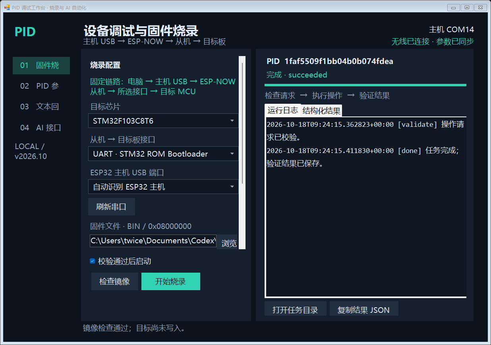

# 无线 PID 调试与烧录工作台

2026-10-24 补充：「03 无线串口」现可使用 H2 双向收发，并保留 H1 日志；新功能请看 [无线串口说明](WIRELESS_SERIAL.md)。

使用手册 V1.2 | 2026-10-19

适用硬件：ESP32-S3 主机 + ESP32-S3 从机；实板目标为 STM32F103C8T6、STM32F407VET6。

这套设备把旋钮调参、无线连接、目标板烧录和数据回传放在同一条硬件链路中。电脑软件和 AI 使用相同的任务引擎，所有目标操作均经主机与从机完成。

**固定路径：电脑 → 主机 USB → ESP-NOW → 从机 → 目标接口 → 目标 MCU。**

主机负责旋钮、OLED、RGB、参数保存及电脑接口；从机负责接收无线任务，并通过目标接口接入 STM32 等控制板。ESP-NOW 会启用 Wi-Fi 射频，但无需连接路由器。

## 阅读导航

| 页码 | 内容 | 适合什么时候看 |
|---|---|---|
| 02 | 快速开始与能力范围 | 第一次上电 |
| 03 | 硬件连接 | 接 STM32 目标板 |
| 04 | 旋钮、OLED 与灯光 | 日常操作主机 |
| 05 | 上位机四个页面 | 使用 Windows 软件 |
| 06 | 无线 UART 烧录 | 下载 F103 固件 |
| 07 | 文本与大数据回传 | 验证整条链路 |
| 08 | AI 命令行 | 让 AI 操作设备 |
| 09 | HTTP API 与任务结果 | 集成其他程序 |
| 10 | 故障排查 | 不连接、烧录失败或不亮 |
| 11 | 固件维护与文件位置 | 重烧两块 ESP32、备份资料 |
| 12 | 多从机与扩展规划 | 理解下一步功能 |
| 13 | F407 无线 SWD 接线 | 没有 BOOT0 时使用 SWD |

**版本边界：** F103 UART、F407VET6 SWD 烧录与回传已实板通过；F407VGT6 和 G431 仍待实板验收。多从机和实际 PID 控制为后续功能。

<!-- pagebreak -->

## 01 快速开始与能力范围

### 第一次使用，先确认主从连接

1. 用能传数据的 USB 线把主机接到电脑。给从机正常供电；从机也可接电脑 USB，便于维护和调试。
2. 双击桌面「PID 调试工作台」。端口选择「自动识别 ESP32 主机」。
3. 等待主机 LINK LED 常亮、从机状态 RGB 绿色常亮。上位机应显示无线已连接；参数确认后显示已同步。
4. 转动 P / I / D / STEP，检查 OLED 数值变化、RGB 进入拖影；停止操作 5 秒后应恢复渐变流水呼吸。
5. 打开「PID 参数」，点击「读取参数」。这一步只读取主机，不会烧录目标板。
6. 需要烧录或回传时，再按第 03 页接好目标板，分别执行第 06、07 页流程。

日常使用时，电脑只需连接主机。主从之间通过 ESP-NOW 通信，从机 USB 不承担上位机到目标板的数据通道。

### 当前能用到哪一步

| 功能 | 当前状态 |
|---|---|
| 四旋钮、OLED、主机 RGB | 已实现，现场操作通过 |
| P/I/D/STEP 调节与保存 | 已实现；保存到主机，断电后恢复 |
| 主从无线同步、连接指示 | 已实现；目前固定配对一台从机 |
| RUN / STOP | 从机确认已实现；目标 MCU 执行协议待接入 |
| F103C8T6 无线 UART 烧录 | 实板写入、完整读回及 ROM GO 通过 |
| F103 文本与大数据回传 | 实板通过，支持中文及按字节验证 |
| G431 UART 烧录 | 代码已适配，真实 G431 擦写验收待完成 |
| F407VET6 / VGT6 UART / SWD | VET6 SWD 实板写入、读回、启动和回传通过；VG 及 F407 UART 待实测 |
| GD32、其他接口 | 待实现或待适配 |
| 多从机、颜色身份、实时 PID 曲线 | 规划中，当前界面尚无从机选择功能 |

**怎样理解“已连接”：** 当前连接指示说明两块 ESP32 已交换有效消息；“参数已同步”说明从机确认了当前快照。它们不等于目标 STM32 已应用 PID 参数，也不等于电机已运动。

<!-- pagebreak -->

## 02 硬件连接

### 先分清三个接口

| 接口 | 用途 |
|---|---|
| 主机 Type-C | 电脑连接入口，供上位机及 AI 使用 |
| 从机 Type-C / H1 | 维护从机、查看 ESP32 自身的运行诊断 |
| 从机 H2 | 连接目标 STM32 的 UART、BOOT0、NRST 等信号 |

**H1 是 ESP32 自身调试串口，H2 才是目标板接口。** 以下 H2 的 TX/RX 均按从机视角命名。

### H2 接 STM32F103C8T6

接线前断电，按接口丝印核对方向，不要只凭排针在图上的左右位置判断。

| H2 脚号 | 从机标注 | 目标板连接 | 说明 |
|---|---|---|---|
| 1 | VTREF | 目标 3.3V | 目标侧电平参考，不能接 5V |
| 2 | TX | PA10 / USART1_RX | 从机发送到目标接收 |
| 3 | RX | PA9 / USART1_TX | 目标发送到从机接收 |
| 4 | BOOT | 独立 BOOT0 引脚 | F103 的 BOOT0 不是 PB8 |
| 5 | NRST | 目标 NRST | 由从机控制复位 |
| 6 | GND | 目标 GND | 双方共地 |

1. F103 的 BOOT1 / PB2 保持低电平。BOOT0 交给从机控制，避免跳帽把它固定到电源或地。
2. 目标板使用其正常供电方式；VTREF 是目标侧参考连接，不要把它当成通用 5V 电源口。
3. 接好共地、参考电压和各信号后再上电。烧录时避免其他下载器同时驱动 BOOT0、NRST 或 UART。
4. 需要重新接线或焊接时先断电；接线变化后重新核对端口和板卡身份。

### G431 与预留 SWD

G431 的 BOOT0 按本项目适配接 PB8，启动还受选项字节影响；F103 必须接它自己的独立 BOOT0。两种 MCU 使用各自编译的固件，不能只改软件中的芯片名称。

从机已预留 SWCLK、SWDIO、SWO、NRST、VTREF、GND 等连接。其中 SWCLK / SWDIO / SWO 为从机 GPIO12 / 13 / 14。**F407 SWD 接线、固件及使用步骤见第 13 页；其他芯片的 SWD 暂未适配。**

<!-- pagebreak -->

## 03 旋钮、OLED 与灯光

### 四个旋钮与两个功能键

| 操作 | 当前行为 |
|---|---|
| 转 P、I、D | 按 STEP 增减对应参数，范围 0.00 至 9999.99 |
| 转 STEP | 在 0.01、0.10、1.00、10.00 四档步长间切换 |
| 按下某个旋钮 | 切换该旋钮的预设色，重新开始彩虹渐变 |
| RUN/STOP | 切换启停请求，等待从机确认 |
| SAVE / 上位机“保存到主机” | 将当前 P/I/D/STEP 写入主机 NVS |
| 上位机“载入已保存” | 用主机保存记录覆盖当前 RAM 参数 |

旋钮和上位机修改的是同一组主机参数。只有明确保存才写入保存记录；转动旋钮不会每一格都写 Flash。没有有效记录时，P/I/D 默认 0.00，STEP 默认 1.00。主机重启不会自动恢复 RUN。

### OLED 看哪里

| 显示 | 含义 |
|---|---|
| P / I / D / STEP | 当前四项数值；最近操作项会高亮 |
| `*` / `SAVED` | 当前参数尚未保存 / 与保存记录一致 |
| `W OFFLINE` | 无线未连上或已失联 |
| `W SYNC` | 已有无线消息，当前状态仍等待同步确认 |
| `W LINK` | 参数已同步，尚未发出启停请求 |
| `W RUN ACK` / `W STOP ACK` | 从机确认了对应请求 |
| `W ERROR` | 无线初始化错误，需要读取诊断信息 |

### 当前灯光规则

主机 40 颗 RGB：空闲时整圈渐变流水并同步呼吸；操作任意旋钮后，共用一个跟随方向的彩虹拖影，背景显示低亮互补色。停转后位置保持，颜色继续变化；5 秒无操作后平滑回到呼吸。当前全局亮度上限为 30/255，呼吸最低强度约为峰值的 10%。

主机独立 LINK LED：收到有效从机应用层确认后常亮，未连接或失联时熄灭。从机自动状态 RGB：连接时绿色常亮，未连接时绿色呼吸；RUN/STOP 不改变颜色。

**注意：** 多从机的 GREEN / BLUE / PURPLE 身份色和每秒两次快速呼吸尚未实现。当前主机灯环保留交互效果，从机状态色固定绿色。

<!-- pagebreak -->

## 04 上位机四个页面



图示为当前界面；右侧可能显示历史任务，实际结果以本次任务 ID 为准。显示比例会随 Windows DPI 调整。

| 页面 | 用途 | 操作重点 |
|---|---|---|
| 固件烧录 | 选择芯片、从机接口和 BIN，检查并提交任务 | 端口始终选主机 USB；当前可执行接口为 UART |
| PID 参数 | 读取、设置参数，RUN/STOP，保存或载入 | “应用参数”和“保存到主机”是两个操作 |
| 文本回传 | 输入文字、选择文件或生成 128 KiB 文本 | 目标必须运行 F103 UART_ECHO 应用 |
| AI 接口 | 查看 CLI / HTTP 用法、复制请求、打开文档 | GUI 与 AI 共用后台任务引擎 |

选择 F407VET6 / VGT6 时默认使用从机 SWD，无需 BOOT0；其他未适配芯片的 SWD 按钮禁用。VET6 为 512KB，VGT6 为 1MB，须选择正确型号。

“检查镜像”只检查本地文件；“开始烧录”会实际替换目标固件。任务执行期间可以查看日志及结构化结果。关闭窗口不会强行终止后台任务，再打开可继续查看。

<!-- pagebreak -->

## 05 无线 UART 烧录 F103

### 准备

主机和从机已连接；两块 ESP32 分别运行 `host_flash`、`slave_flash` 固件；H2 接线正确、目标板已供电。准备给 STM32F103C8T6 编译的 `.bin`，链接起始地址为 `0x08000000`。

### 按这个顺序操作

1. 在“固件烧录”选择 `STM32F103C8T6`。
2. 从机接口选择 `UART · STM32 ROM Bootloader`，端口选择“自动识别 ESP32 主机”。
3. 浏览并选择目标 `.bin` 文件，点击“检查镜像”，查看字节数、容量及 SHA256。
4. 如果希望写入后马上启动，勾选“校验通过后启动”。不勾选则不发送显式启动请求。
5. 点击“开始烧录”。程序先 STOP 并等待从机确认，再经无线传送文件。
6. 从机接收完整镜像、验证 SHA256 及向量表后，进入目标 ROM，核对芯片与容量，擦除镜像覆盖页、写入并完整读回。
7. 查看本次任务的结构化结果。成功后还应通过目标应用现象或通信确认实际运行，例如测试程序的 PA3 输出或 UART 回传。

### 什么才算烧录成功

| 项目 | 要求 |
|---|---|
| 任务状态 | `state` 为 `succeeded` |
| 写入验证 | `result.verified` 为 `true` |
| 若勾选启动 | 还需 `result.go_ack` 为 `true` |
| 实际应用 | 另看目标行为；ROM 接受跳转不等于应用功能全部正常 |

进度接近 100%、主从在线或 UART 收到 ACK，都不能单独代替完整读回结果。烧录结束后保持 STOP，不自动恢复 RUN。

### 当前限制与失败处理

只支持从 `0x08000000` 开始的 BIN；暂不支持 HEX、ELF、偏移应用或自动解除读写保护。F103C8 始终按 64 KiB Flash / 20 KiB RAM 限制，即使本块实板容量回报为 128 KiB，也不使用后半空间。G431 适配需另行实板验收。

出现失败先保留任务 ID、日志和 JSON。擦写中避免断电；断电或状态不明时先核对目标再重试。不要因为等待超时就连续创建新烧录任务。

<!-- pagebreak -->

## 06 文本与大数据回传

这项测试验证完整路径：电脑 → 主机 → ESP-NOW → 从机 UART → STM32，再沿原路返回电脑。它用于检查丢失、损坏、重复及回传内容是否一致。

### 先让目标运行回传固件

F103 选择 `STM32F103_UART_ECHO/uart_echo.bin`；F407VET6 选择 `STM32F407_UART_ECHO/uart_echo.bin` 并用 SWD 烧录。均勾选启动，使用 PA9/TX、PA10/RX 的 USART1 接收测试帧；F103 应用另维持 PA3 高电平。两种 BIN 不能混用。

ROM 烧录串口为 115200 / 8E1；回传应用为 115200 / 8N1。从机自动切换，使用者无需手动改串口格式。ROM Bootloader 本身不会回传任意文本，目标必须运行对应应用。

### 上位机操作

1. 打开“文本回传”，先选择“输入文字”。
2. 输入一小段，例如“你好，STM32！ABC123”，点击“开始回传测试”。
3. 短文本通过后，可选择已有文件，或“自动生成 128 KiB 文本”。
4. 查看本次任务的结构化结果及返回预览；在任务目录比较原文与回传文件。

| 成功依据 | 要求 |
|---|---|
| 任务状态 | `state:succeeded` 且 `result.passed:true` |
| 每块数据 | 返回内容与发送内容逐块一致 |
| 整体统计 | 总字节数、唯一块数及目标流 CRC32 一致 |
| 整文件 | 返回文件与原文 SHA256 一致 |

测试按字节传输，支持 UTF-8 中文和二进制。输入文字最多 16384 个字符；文件或生成数据大小为 1 字节至 4 MiB。二进制的预览可能不可读，应比较保存的文件与校验结果。

### 丢包怎样处理

无线允许出现重传；重传次数不为零并不等于最终丢数据。协议使用会话、传输 ID、序号、偏移、CRC32、应用层确认、有界重试和重复请求处理；最终仍须通过整份数据校验。重试耗尽会明确失败，保存已返回的部分数据。

实板记录：F103 的 131091 字节正常/故障轮次约 57/158 秒；F407VET6 同样大小为 53.546/155.954 秒，故障轮次无线重试 714 次、串口重试 146 次，最终全文一致。这是当前环境下的实测结果。

**区分容量：** 128 KiB 回传数据是流式处理的测试数据，不是给 64 KiB F103C8 烧录一个 128 KiB 固件。

<!-- pagebreak -->

## 07 AI 命令行操作

在 `PID_Workbench` 目录打开 PowerShell，调用 `pidctl.cmd`。CLI 自动启动本地后台并读取认证信息，输出 JSON，无需让 AI 操作鼠标。

### 先读取能力和状态

```powershell
./pidctl.cmd capabilities
./pidctl.cmd ports
./pidctl.cmd device --port auto
```

检查接口的 `available`。当前 F407 支持 UART / SWD，其他芯片支持 UART；核对各芯片的 interfaces 字段。`port` 始终是主机 USB；不要选择从机 COM 口或另一个 USB-TTL 转换器。

### 检查镜像，再提交烧录

下面文件路径为示例，需替换成实际 BIN。烧录命令会替换目标应用。

```powershell
./pidctl.cmd plan --chip STM32F103C8T6 --interface uart `
  --firmware 'C:/firmware/app.bin'
./pidctl.cmd flash --chip STM32F103C8T6 --interface uart `
  --firmware 'C:/firmware/app.bin' `
  --idempotency-key build-001 --wait
```

`plan` 不写目标。`flash` 默认请求校验后启动，添加 `--no-run` 可关闭显式启动。可把 plan 返回的 SHA256 通过 `--expected-sha256` 传给 flash，防止两步之间选中的文件发生变化。

### 回传、参数与任务查询

```powershell
./pidctl.cmd echo --text '你好，STM32' --idempotency-key echo-001 --wait
./pidctl.cmd echo --bytes 131072 --idempotency-key echo-large-001 --wait
./pidctl.cmd pid --p 1.25 --i 0.12 --d 0.15 --step 0.01 `
  --idempotency-key pid-001 --wait
./pidctl.cmd stop --idempotency-key stop-001 --wait
./pidctl.cmd job TASK_ID
./pidctl.cmd wait TASK_ID --timeout 1800
```

`TASK_ID` 替换成提交时返回的任务 ID。上述 PID 数值只是调用示例，不是具体电机或舵机的调参建议。`run`、`save`、`load` 使用相同任务参数形式；只有用户明确需要保存时才发 `save`。

### 任务键怎样使用

同一操作保留同一个 `idempotency_key`。网络超时后，用相同请求和相同键重试，或先查询已有任务；后台会返回原任务，不重复执行。换固件、换参数或明确开始新一次操作时才用新键。同键不同内容返回 `idempotency_conflict`，失败记录也不会自动重执行。

示例行末的反引号是 PowerShell 续行符，后面不要加空格。CLI 返回非零退出码时读取 JSON 的 `error.code` 和 `error.message`；“任务已提交”不等于“目标已完成”。

<!-- pagebreak -->

## 08 HTTP API 与任务结果

本地服务地址为 `http://127.0.0.1:18765`，仅允许本机调用。GUI 与 AI 共用任务引擎，同一时间执行一个硬件任务。

### 认证与接口

```powershell
$apiToken = (Get-Content "$env:LOCALAPPDATA/PIDWorkbench/api_token.txt" -Raw).Trim()
$headers = @{ Authorization = "Bearer $apiToken" }
Invoke-RestMethod 'http://127.0.0.1:18765/v1/capabilities' -Headers $headers
```

token 保存在本机，不要复制进提示词或日志。POST 请求使用 `Content-Type: application/json`。接口定义也保存在 `openapi.json`。

| 方法与路径 | 用途 |
|---|---|
| GET `/v1/capabilities`、`/v1/ports` | 查询能力、接口可用状态和串口身份 |
| GET `/v1/device?port=auto` | 读取主机参数和链路；忙时可能返回缓存 |
| POST `/v1/plan` | 只检查镜像和执行路径，不写目标 |
| POST `/v1/jobs` | 提交带任务键的明确操作 |
| GET `/v1/jobs`、`/v1/jobs/{id}` | 查询任务列表、日志及结果 |
| GET `/v1/openapi.json` | 获取 OpenAPI 3.1 定义 |

### 烧录请求体示例

```json
{
  "action": "flash",
  "chip": "STM32F103C8T6",
  "transport": "esp_now",
  "target_interface": "uart",
  "firmware": "C:/firmware/app.bin",
  "port": "auto",
  "run": true,
  "idempotency_key": "build-001"
}
```

成功响应以 `ok:true,data:...` 包装；错误响应为 `ok:false,error:{code,message}`。任务状态从 `queued` 变为 `running`，最后为 `succeeded` 或 `failed`；服务意外退出后未完成任务标为 `interrupted`，不会自动重烧。

`device_busy` 表示已有硬件操作，可稍后使用原键重试。`unsupported_chip_interface` 表示所选芯片与从机接口尚未适配。`sync_timeout` 时主机可能已执行本地操作但未等到从机确认，应先读状态。`cached:true` 的数据是缓存，不能作为当前目标状态的实测证据。

<!-- pagebreak -->

## 09 常见问题与排查顺序

| 现象 | 先做什么 |
|---|---|
| 上位机找不到主机 | 确认数据线、主机 USB 接口及 Windows 串口枚举；刷新端口，用 CLI `ports` 对照身份 |
| COM 口拒绝访问或忙 | 结束占用它的串口监视器、旧 RGB 上位机连接或其他脚本；不要同时开多个串口工具 |
| 从机绿色呼吸、主机 LINK 灭 | 检查从机供电、两端固件、固定 MAC 与共享密钥；当前只支持原配一台从机 |
| RGB 不亮 | 先用 `device` 或诊断应答判断 ESP32 是否运行，再查灯珠 5V、共地和数据链路，不能仅凭灭灯判断芯片没启动 |
| OLED 黑屏 | 主机当前 SDA=GPIO8、SCL=GPIO9，地址 0x3C；核对 3.3V、共地和接线。别套用旧的反向引脚配置 |
| 一个机械卡点不更新数值 | 检查该旋钮 A/B 输入，再核对每步跳变设置；当前主机默认每步 2 跳变 |
| 选了 SWD 却不能点烧录 | 当前从机 SWD 适配 F407VET6 / VGT6；其他芯片使用 UART |
| UART ROM 握手失败 | 查 PA9/PA10 交叉、BOOT0、F103 BOOT1=0、NRST、VTREF 及共地，确认没接到 H1 |
| 文本回传握手失败 | 目标可能仍在 ROM、程序未启动或已被换成别的应用；重新确认 UART_ECHO 固件及启动结果 |
| 失联后设备没有自动 RUN | 当前按 STOP 处理，不自动续跑；重连并确认状态后，再明确发出 RUN 请求 |
| 刷了 ESP32 后烧录功能消失 | 很可能刷了基础无线环境；恢复 `host_flash` / `slave_flash` |

### ESP32 无法正常进入下载时

按住 SW8（BOOT），按下并松开 SW7（RESET），等待约 1 秒后松开 SW8，再检查下载端口。仅在无法正常下载时采用这个步骤；平时运行不需要一直按 BOOT。上传后释放所有按键，再按一下 RESET 运行应用。

### 仍无法定位时，保留这些信息

记录出问题的是主机、从机还是目标板；保存本次任务 ID、芯片选择、BIN 的 SHA256、结构化结果和日志。重启、断电或焊接前先记下现象，避免把重启前后的状态混在一起。

**关于失败任务：** 擦写中断后不要连续换任务键尝试。先查结果及目标状态，再决定是否重新进入 ROM、从擦除开始烧录。主机、从机或目标断电后，不能假定 RAM 中的传输会话仍存在。

<!-- pagebreak -->

## 10 固件维护、备份与文件位置

### 重新烧录两块 ESP32

打开各自 VS Code / PlatformIO 工程，明确选择包含目标烧录功能的环境。

| 板卡 | 工程目录 | 日常需要的完整环境 |
|---|---|---|
| 主机 | `ESP32_S3_RGB_Chase` | `host_flash` |
| 从机 | `ESP32_S3_Slave_Diagnostic` | `slave_flash` |

分别在对应工程目录运行。COM14 / COM18 为本机当前映射，上传前用端口身份核对，编号改变时替换命令中的端口。

```powershell
# 在主机工程目录
& "$env:USERPROFILE/.platformio/penv/Scripts/platformio.exe" `
  run -e host_flash -t upload --upload-port COM14
# 在从机工程目录
& "$env:USERPROFILE/.platformio/penv/Scripts/platformio.exe" `
  run -e slave_flash -t upload --upload-port COM18
```

大于 128 KiB 的 F407 镜像使用从机 `slave_flash_psram`，见第 13 页。默认 `host_wireless` / `slave_wireless` 只有基础无线功能。`host_local` / `slave_diagnostic` 关闭无线；独立外设测试版不能代替日常固件。`slave_flash_transport` 不允许目标编程。

### 设备身份与换板

当前主机 MAC / USB 身份为 `44:1B:F6:8D:10:20`，从机为 `44:1B:F6:8D:10:18`。当前无线库固定配对并核对本机 MAC；更换模组后，需要同步维护共享库中的配对身份和电脑识别配置，重新编译两端。

两端使用同一份 `PID_Shared/PIDLink/private/pair_keys.h`。它是共享配对密钥资料；备份时保留，向他人分享或公开仓库时妥善处理。换电脑只复制一个工程，可能遗漏共享库、密钥或工具。

### 文件在哪里

| 位置 | 内容 |
|---|---|
| `PID_Workbench` | 上位机 EXE、源码、CLI、README、AI_USAGE、接口定义 |
| `PID_Shared/PIDLink`、`PIDFlash` | 共用无线、烧录、回传协议与工具 |
| `STM32F103_UART_ECHO` | 回传应用源码、`uart_echo.bin`、测试脚本 |
| `%LOCALAPPDATA%/PIDWorkbench/jobs/任务ID` | 固件快照、事件日志、回传文件及结果 |
| `%LOCALAPPDATA%/PIDWorkbench` | `jobs.sqlite3`、界面设置、后台日志和本机认证 token |

本机项目根目录：`C:/Users/twice/Documents/Codex/2026-10-01/pid/outputs`。主机参数保存于板上 NVS，不会因复制电脑上的界面设置文件而自动备份。

<!-- pagebreak -->

## 11 多从机与扩展规划

**多从机仍为规划功能。** 当前固件固定配对一个从机，没有添加、命名、选择多从机或保存身份色的入口。其他扩展的当前状态见下表。

### 身份颜色与连接状态

| 规划名称 | 身份色 | 连接正常 | 未连接或失联 |
|---|---|---|---|
| GREEN | 绿色 | 绿色常亮 | 绿色快速呼吸 |
| BLUE | 蓝色 | 蓝色常亮 | 蓝色快速呼吸 |
| PURPLE | 紫色 | 紫色常亮 | 紫色快速呼吸 |

快速呼吸暂按每秒两次设计，最终以实现及现场效果为准。颜色和名称方便人识别；真正的通信身份使用 MAC / 设备 ID，改名或换颜色不应改变实际地址。

规划中，上位机选择一台从机后，调参、烧录及回传只发给这一台；主机 OLED 显示选中名称与状态。每台从机分别维护连接、参数和任务结果，避免把 A 的确认误认为 B 的确认。切换设备及烧录中锁定目标的规则需要一起实现。

### 后续功能的接入条件

| 方向 | 需要补齐的内容 |
|---|---|
| 多从机 | 设备列表、配对管理、独立心跳、目标选择、按设备路由与任务绑定 |
| 无线 SWD | F407VET6 实板写入、读回及启动通过；VGT6 待实测，其他算法继续扩展 |
| 实际 PID 控制 | 目标 MCU 参数与启停协议，以及来自目标的执行确认 |
| PID 曲线 | 目标值、测量值、控制输出、时间戳及采样率约定；上位机绘图与记录 |
| GD32 / 其他芯片 | 对应 Bootloader 或 Flash 算法、芯片识别及实物验证 |

当前 AI API 没有 `device_id` 选择字段，也没有可执行的多从机颜色配置接口。不要把本页的设计名称当成已有命令。

### 维护本手册

本手册对应后台 `2026.10.19.2`。F103 UART、F407VET6 SWD 已实板验收；VGT6 仅完成模拟验证。更新固件、接线或 API 后，应同步更新文档与验收范围。

进一步查阅项目内 `PID_Workbench/AI_USAGE.md`、`PID_Shared/PIDFlash/README.md`、`PID_Shared/PIDFlash/ECHO.md` 和各工程的 `validation` 记录。旧文档中的历史环境、亮度、灯效和待验收描述，以本手册标明的当前版本与最新记录为准。


<!-- pagebreak -->

## 12 F407 无线 SWD 接线与使用

**没有 BOOT0 引出也可以使用 SWD。** 路径仍是电脑 → 主机 USB → ESP-NOW → 从机 H3 → F407；不使用电脑直连 ST-Link。

### 从机 H3 到 F407

| 从机 H3 | 标注 | F407 目标板 | 备注 |
|---|---|---|---|
| 1 | VTREF | 目标 3.3V | 电平参考，不接 5V |
| 2 | SWDIO / DIO | PA13 / SWDIO | 对应从机 GPIO13 |
| 3 | SWCLK / CLK | PA14 / SWCLK | 对应从机 GPIO12 |
| 4 | GND | 目标 GND | 双方共地 |
| 5 | SWO | 可不接 | 本版不使用 SWO |
| 6 | NRST | 目标 NRST | 对应从机 GPIO15 |

五根线即可，H3 的第 5 脚留空。目标板正常供电；BOOT0 / BOOT1 保留正常启动配置，不由从机切换。SWDIO 与 SWCLK 按名称对应，不交叉连接。

### 固件与上位机

1. 两块 ESP32 都安装新版固件：主机 host_flash，从机 slave_flash；大于 128 KiB 的镜像使用 slave_flash_psram，适用于当前 N16R8。
2. 按丝印选择 STM32F407VET6（512KB）或 STM32F407VGT6（1MB），默认从机 SWD；USB 端口仍选主机。
3. 选择给 F407 编译、起始地址 0x08000000 的 BIN，先检查镜像再提交烧录。不能使用 F103 的 uart_echo.bin。
4. 成功要求 state:succeeded、result.verified:true；请求启动时还需 result.start_ack:true。SWD 通过复位启动，不以 ROM go_ack 为判据。

F407VE 按 512 KiB、VG 按 1024 KiB 校验，型号与实读容量不符会停止。初始栈须位于主 SRAM：0x20000000 < SP <= 0x20020000。Flash 只擦除覆盖镜像的完整扇区；扇区内其他旧数据也会擦除。

### 验证范围

F407VET6 已通过无线 SWD 实板写入、完整读回、启动及 131091 字节 UART 回传。VGT6 的 1MiB 算法仅模拟通过，满容量实板烧录仍待验收。从机 GPIO 已修正为 CLK12 / DIO13 / SWO14；详见 docs/F407_SWD_WIRING.md。

官方资料：ST F407 数据手册（stm32f407vg.pdf）、RM0090 与官方 CMSIS F407 寄存器定义。
